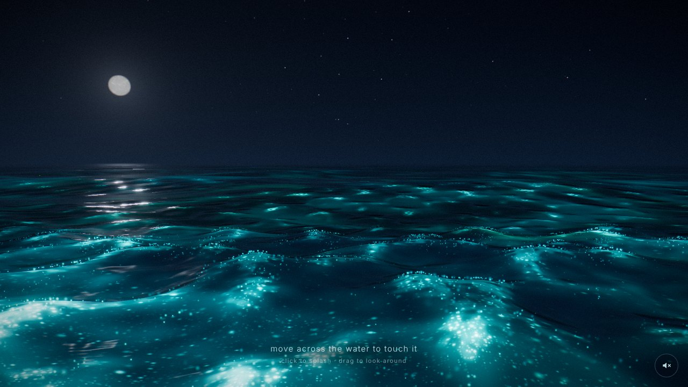

# Luminescent Ocean

A real-time, cinematic WebGL scene of the open sea at night, where the water glows with bioluminescent plankton. Crests sparkle, patches of plankton drift and morph, and anything that disturbs the water — your mouse, your finger, a passing fish — leaves a glowing wake that spreads and fades.



Built with **Next.js 16 (App Router, TypeScript)**, **three.js r186**, **@react-three/fiber 9**, **@react-three/drei**, **@react-three/postprocessing** and hand-written GLSL.

**Live:** https://karthi-98.github.io/luminescent-ovean/ (deployed by `.github/workflows/pages.yml` on every push).

## Run it

Requires Node.js ≥ 20.9.

```bash
npm install
npm run dev        # http://localhost:3000  (leva debug panel visible)
```

Production (a fully static export in `out/`, also what GitHub Pages serves):

```bash
npm run build
npm start          # serves out/ at http://localhost:3000  (no debug panel)
npm run typecheck  # optional
```

### Controls

| | Mouse / pen | Touch (phones, tablets) |
|---|---|---|
| Touch the water (glowing wake) | hover over the sea | drag one finger |
| Splash + particle flare | click / tap | tap |
| Look around (360°) | drag | two-finger drag |
| Ambient sound | 🔈 button, bottom right (muted by default) | same |

On portrait phones the vertical field of view widens beyond 50° so that at least ~34° remain horizontally, and the opening view turns towards the moon.

### URL options

- `?debug` — show the leva panel in a production build.
- `?quality=low|medium|high` — pin a quality tier (turns adaptive quality off).

## Project structure

```
app/
  layout.tsx, page.tsx, globals.css   fullscreen page + overlay styles
components/
  OceanExperience.tsx   client shell: device detection, WebGL check, fade-in, debug panel
  Overlay.tsx           hint ("move across the water…") + sound toggle
  ocean/
    Scene.tsx           Canvas, frame driver (60 fps cap), adaptive quality, post-processing
    Water.tsx           camera-following radial grid + water material
    RippleSim.ts        ping-pong interaction heightfield (+ glow-energy channel)
    Interaction.tsx     pointer/touch → ray-cast onto the waves → RippleSim
    Plankton.tsx        GPU particles
    UnderwaterLife.tsx  glowing fish darting under the surface
    Sky.tsx             gradient dome, moon, 3 000 twinkling stars
    CameraRig.tsx       boat camera: look-around + wave-synced bob/roll
    FilmGrain.ts        artefact-free grain effect
    OceanAudio.ts       procedural ambient sound (Web Audio)
    DebugControls.tsx   leva panel (dev / ?debug only, lazy-loaded)
    config.ts           every default parameter in one place
    state.ts            live params + shared uniforms
    waves.ts            CPU mirror of the Gerstner waves (camera, ray-cast)
    colors.ts           display colour ↔ scene radiance (inverse ACES)
    shaders/            water.vert/.frag, glow.glsl, waves.glsl, sky.*, stars.*,
                        particles.*, ripple.*, noise.glsl, common.glsl
```

## How it works

**Waves.** Eight Gerstner waves (two 46–72 m swells, six 2–8 m chop waves) are summed in `shaders/waves.glsl` with analytic tangent frames, so normals need no finite differences. The *Jacobian* of the horizontal displacement drops towards 0 where crests compress — that is where waves break, and it drives the crest glow. `waves.ts` evaluates the very same sum on the CPU, so the camera bobs on the waves you see and the pointer ray-cast hits the surface that is rendered.

**Infinite sea.** The water is a polar grid centred on the boat: ~0.12 m spacing under the camera, growing with distance out to 6 km. Waves shorter than the local grid spacing (vertex) or pixel footprint (fragment) are faded out, and the slope variance they would have contributed is added to the moon highlight's roughness. Distant water fades into the sky's own colour at the horizon in every direction, so there is no edge or seam.

**The glow** (`shaders/glow.glsl`, `water.frag`): *amount of plankton × how hard it is stirred × granular structure*.

1. *Plankton amount* — domain-warped fBm patches that drift and morph slowly, thinner (never zero) between patches.
2. *Stirring* — the waves themselves (crest faces glow, troughs stay dark), breaking crests from the Jacobian (broken up by foam noise), and the interaction field's glow energy.
3. *Structure* — a soft, bluer diffuse part (light scattered under the surface) plus three octaves of flashing "cells": hash-placed sparks with power-law brightness. Stirring both brightens them and raises the fraction of cells that are lit, like real dinoflagellates. Sparks are blurred by the pixel footprint with their energy conserved, and fade to their mean once smaller than a pixel, so distant water never crawls.

**Interaction** (`RippleSim.ts`, `shaders/ripple.frag`): a 128–512² half-float wave-equation heightfield that follows the boat. Besides height it carries a separate *glow energy* channel that diffuses and decays exponentially, so a wake glows steadily and fades smoothly instead of flickering with the ripples. It runs on a fixed 60 Hz step with physical units, so it behaves the same at any frame rate or resolution.

**Particles** (`Plankton.tsx`, `shaders/particles.vert`): 9–42k points riding the exact wave surface. They stay dark until a crest passes (with a short afterglow), a wake or fish stirs them, or a splash flares them and throws the nearest ones up as glowing spray. Dark particles are culled in the vertex shader.

**Colour.** The sky and water colours in `config.ts` are what you *see*: `colors.ts` inverts the ACES Filmic curve so the tone-mapped result lands on the authored hex values. Glow colours are HDR light, and bloom only catches what is above the luminance threshold.

## Tuning the look

Everything lives in [`components/ocean/config.ts`](components/ocean/config.ts). In `npm run dev` the leva panel edits the same values live; copy the numbers you like back into `config.ts`.

| You want… | Change |
|---|---|
| more / less glow overall | `glow.intensity` (master), `post.bloomIntensity` |
| calmer, darker sea between events | lower `glow.ambient` |
| brighter, more frequent breaking crests | raise `glow.crest`, lower `glow.crestThreshold` |
| bigger / smaller plankton patches | `glow.noiseScale` (smaller = bigger patches) |
| more of the sea glowing | `glow.patchCoverage`, `glow.baseDensity` |
| smoother vs. more sparkly glow | `glow.granularity` (0 = smooth, 1 = all sparks), `glow.sparkleScale` |
| other glow colours | `glow.colorA` (core), `glow.colorB` (teal), `glow.deepColor` |
| longer / shorter wakes | `ripple.glowLifetime` (seconds), `glow.ripple` (brightness), `ripple.brushRadius` |
| rougher / calmer sea | `waves.amplitude`, `waves.speed`, or edit `waves.list` (keep Σ steepness ≤ 1) |
| stronger moon path | `water.moonSpecular` (1 = physically matched), `moon.elevation` |
| more / less haze | `water.fogDensity` |
| gentler boat motion | `camera.bobStrength`, `camera.rollStrength` |
| sky colours | `sky.zenith`, `sky.horizon` (exact on-screen colours) |
| opening moment | `startTime` — patches drift slowly, so this picks the first view |

## Performance

- Frame rate is capped at 60 fps (a 120 Hz phone would otherwise render twice as many frames and heat up; 75/90/144 Hz screens still average 60), and rendering stops entirely while the tab is hidden.
- Long sessions stay smooth: the fast wave phases are wrapped on the CPU in double precision every frame, so float32 shader precision never degrades the animation.
- DPR is clamped to [1, 1.5] on phones and [1, 2] on desktop.
- **Adaptive quality** (drei `PerformanceMonitor`): when the frame rate drops, the pixel ratio comes down first, and only then the quality tier. Headroom reverses this, but a tier only steps up when the scene is running at the 60 fps cap. The targets are about 53+ fps on desktop and 29+ fps on phones. Repeated flip-flopping locks upward moves (2 min, then 4, 8…), so it settles instead of thrashing. If cuts don't raise the frame rate because something else limits it (browser power saving, a 30 Hz screen, a busy CPU), they are undone, so quality isn't lost for nothing. Live trails survive tier changes: the ripple field is resampled, not reset.

| tier | particles | ripple texture | bloom mips | MSAA | shader detail |
|---|---|---|---|---|---|
| high (desktop start) | 42 000 | 512² | 8 | 4× | full |
| medium (phone start) | 22 000 | 256² | 6 | – | full |
| low | 9 000 | 128² | 5 | – | reduced (fewer noise lookups, sparks, micro-waves) |

- No allocations inside `useFrame` (scratch objects are reused); geometries, materials and render targets are disposed on unmount.

## Notes

- **Audio.** The brief suggested Howler.js; the scene uses a small procedural Web Audio graph instead (`OceanAudio.ts`): filtered brown/pink noise whose swell and hull slaps follow the boat's actual motion. There's no audio file to license or download, and it never loops audibly. It is muted until you press the sound button.
- **Requirements.** WebGL 2 with renderable half-float textures (`EXT_color_buffer_half_float`/`EXT_color_buffer_float`; supported by all current desktop and mobile browsers). Without them, the interaction field is switched off and the rest still renders.
- **Credits.** 3D simplex noise by Ian McEwan & Stefan Gustavson (Ashima Arts, MIT). PCG hash by Jarzynski & Olano, "Hash Functions for GPU Rendering" (JCGT 2020).
